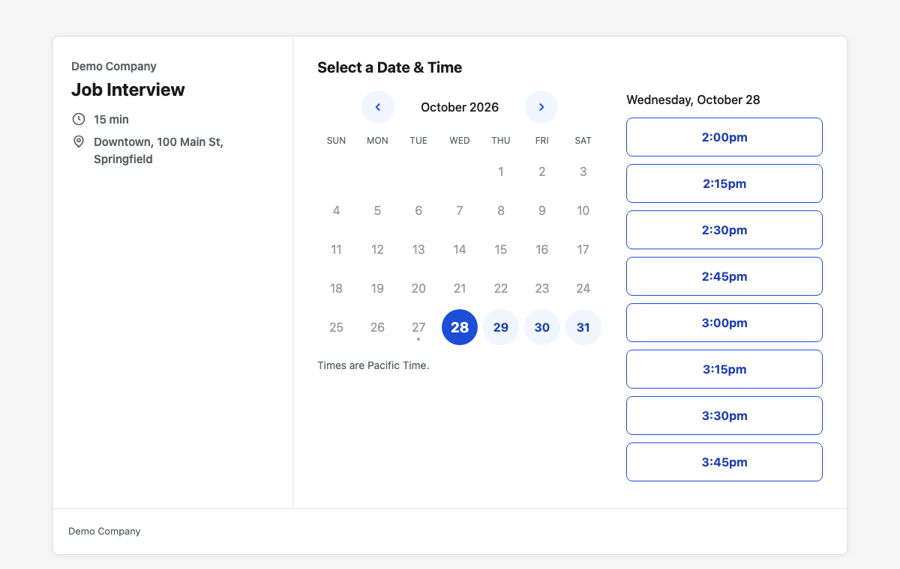
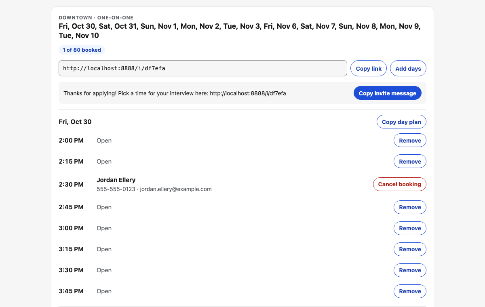

# Interview Scheduler

Self-hosted interview booking: share a link, candidates pick a time, get a confirmation email with a calendar file, and can move or cancel their own booking. An admin page creates the links and shows who booked. Runs on Netlify Functions and Netlify Blobs, no database.

| Booking page | Admin |
|---|---|
|  |  |

## Features

- **Booking links** per location: one-on-one (15-minute slots) or group sessions with a seat limit
- **No double booking**: each seat is a create-only blob key, so two people racing for the last seat can't both get it
- **Self-service changes**: every booking has a private manage link (`/?t=<token>`) to reschedule or cancel; rescheduling frees the old seat only after the new one is held
- **One open booking per email**: a second booking with the same email is refused, and knowing someone's email is not enough to move their interview
- **Emails** for booked / moved / cancelled, with an `.ics` calendar attachment; HTML built with tables and inline styles so Gmail and Outlook render it
- **Admin** (`/admin`, password from `ADMIN_PASSWORD`): create links for a location, add days, remove free times, see and cancel bookings, copy a day plan or the invite message, and edit locations, rules and every text. Signed HttpOnly session cookie, JSON-only API, 10 wrong passwords per device and hour
- **Retention**: bookings (name, phone, email) are deleted a set number of days after the interview
- **Editable texts and rules** in a settings blob (page texts, email texts with `{placeholders}`, booking cutoff, days ahead, per-device rate limit), applied without a deploy
- **Spam protection**: honeypot field and a per-IP hourly limit
- **Accessible, mobile-first booking page**: keyboard navigable calendar, labelled fields with inline errors, 44px+ tap targets, strict CSP and no third-party requests

## Tech stack

Vanilla HTML/CSS/JS front end · Netlify Functions (Node, ES modules) · Netlify Blobs · Nodemailer · `node:test`

## Getting started

Requires Node 20+.

```bash
npm install
npm run dev     # local server on http://localhost:8888 with a local blob store
npm run seed    # in a second terminal: demo links for the next two weeks, prints their URLs
```

Open one of the printed `/i/<id>` URLs to book, and http://localhost:8888/admin/ to manage the links (password `demo` under `netlify dev` when `ADMIN_PASSWORD` isn't set; a deployed site without it has no admin). Emails are optional: without `GMAIL_USER` / `GMAIL_APP_PASSWORD` (see `.env.example`) bookings work and the email step is skipped with a log line. Addresses at `example.com` never get mail.

## Tests

```bash
npm test          # slot builder, admin login and settings, email rendering; no server needed
npm run test:race # against `npm run dev`: seat limits, reschedule, cancel, validation, rate limit, settings
```

## Project structure

```
netlify/functions/api.mjs   API: GET page, slots, booking; POST book, cancel; /api/admin/* for the admin
netlify/lib/admin.mjs       admin login, session cookie, settings validation, retention
netlify/lib/slots.mjs       builds links and slots (time zone aware, DST safe)
netlify/lib/settings.mjs    default texts and rules, merged with the settings blob
netlify/lib/email.mjs       email text, HTML and .ics, sent with Nodemailer
public/index.html           booking page (calendar, times, details, manage booking)
public/admin/index.html     admin page (links, bookings, settings)
scripts/seed.mjs            demo data for local development
test/                       unit tests and the booking race test
```

### Blob layout

| Key | Content |
|---|---|
| `links` | `[{ id, store, kind, slots: [{ id, start, minutes, seats }] }]` |
| `seat/<slotId>/<n>` | one key per taken seat, written with `onlyIfNew` |
| `booking/<token>` | the booking record |
| `email/<sha256>` | token of that email's open booking |
| `settings` | stores, rules, page and email texts |
| `rate/<sha256>`, `adminfail/<sha256>` | per-device counters for bookings and failed admin logins |

## License

MIT
